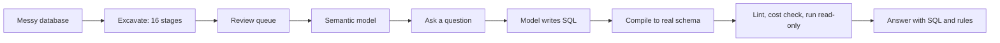

<div align="center">

# Stratum

**Ask questions of databases nobody documented.**

[](https://stratum.wm-waleedmaqbool.workers.dev)


<br>


</div>

<br>

## The idea

Old databases carry decisions nobody wrote down: cryptic names, no foreign keys, one table holding several kinds of record, money that switched from dollars to cents partway through, rows that were only marked as deleted.

Stratum reads the schema and the data, works out what it all means, and compiles that into a **semantic model a person can review and correct**. Then it answers plain-English questions and shows the SQL it ran and every rule it applied.

> **The language model writes SQL against a clean, virtual schema. A deterministic compiler rewrites it for the messy real one.**
> Renames, casts, soft-delete filters, table discriminators and unit conversions are applied by reviewed code, not guessed again by a model on every question.

## Results

Same model with and without Stratum, on benchmark databases made deliberately messy. Execution accuracy against gold SQL:

| Database | Model | Plain baseline | **Stratum** | Tokens per question |
|---|---|---:|---:|---:|
| Chinook (SQLite) | gpt-oss-120b | 23.9% | **60.9%** | 5,817 to **3,095** |
| Pagila (Postgres 16) | a Qwen 27B model | 30.8%* | **57.8%** | 3,711* to **2,354** |

<sub>*The Pagila baseline covers 26 of 45 questions, because the daily token quota ran out. Joins are found with F1 of 1.00 on Chinook and 0.85 on Pagila.</sub>

The gains are largest where the mess is worst (Chinook, baseline to Stratum):

| Problem | Baseline | Stratum |
|---|---:|---:|
| Mixed column types | 0% | **80%** |
| Schema drift | 7.1% | **64.3%** |
| Soft deletes | 23.3% | **63.3%** |
| One table, several kinds of record | 15.8% | **63.2%** |
| Vague question | 20% | **60%** |
| Missing foreign keys | 31.6% | **57.9%** |
| Messy strings | 0% | **37.5%** |

## A real answer

From the Postgres benchmark (physical SQL abridged). The question was about total revenue.

```sql
-- what the model wrote
SELECT SUM(amount) AS total_revenue FROM payment WHERE txn_typ = 'P'

-- what ran on the database
SELECT SUM(amount) AS total_revenue FROM (
  SELECT ...,
         CASE WHEN txn_ts >= '2022-04-01 00:02:24.640021'
              THEN amt_c / 100.0 ELSE amt END AS amount
  FROM public.fin_txn
  WHERE txn_typ = 'P'
) AS payment
```

It returns 67,416.51, the clean database's total to the cent. Two facts made that possible, and neither is in the schema: `fin_txn` mixes payments with other record types, and amounts moved from a dollars column to a cents column on a cutover date. Stratum found both in the data.

## How it works



- **Excavate.** Sixteen stages, almost all deterministic. Only the last one, which names and describes things, calls a language model.
- **Review.** The queue is ordered by impact. Each inference is stated as one sentence with its evidence, and you accept or correct it.
- **Ask.** Joins are planned deterministically (a Steiner tree over the model). The model proposes two candidate queries, and each is compiled, checked against the connection's SQL profile, cost checked, run, and repaired on error. The answer is picked by agreement between results. The budget is 6,000 tokens per question.

<div align="center">


</div>

## Guarantees

- **Read-only.** Every statement is parsed and must be a single SELECT. It runs in a transaction that is rolled back, with a timeout and a row cap.
- **Private.** Credentials and whole tables never reach a model. Models see schema, profiles and a few sample values.
- **Bounded.** A hard token budget per question.
- **Dialect-safe.** Generated SQL must pass the connection's SQL profile linter.

## The Gauntlet

A benchmark with an answer key. Chinook and Pagila are made messy by a seeded, deterministic legacifier, and gold answers come from the clean copies. There are 46 and 45 question and gold SQL pairs, plus 21 and 27 reversibility checks. The legacifier records every change it makes in a manifest, and the engine never reads it.

## Run it

```bash
make setup       # install dependencies
make gauntlet    # build the clean and messy benchmark databases
make excavate    # run the excavation pipeline
make test        # 125 tests
make engine      # API on :8000
make web         # app on :3000
```

No Docker needed: Postgres runs through `pgserver`. The static demo in `web/` deploys to Cloudflare Workers, and its answers there are recorded, not live.

## Honest limits

- Two databases and one model each. Calibration was fitted on reported questions.
- The Pagila baseline is partial (see above).
- SQLite and Postgres only. The SQL Server connector is untested.
- Enrichment varies a little between runs.
- No ablation study and no BIRD run yet.

Full numbers, caveats and the build log are in [`docs/PROGRESS.md`](docs/PROGRESS.md). The MCP server is described in [`docs/MCP.md`](docs/MCP.md).
