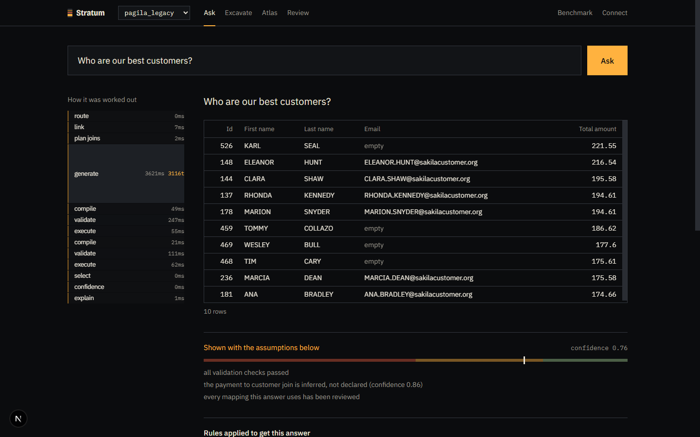
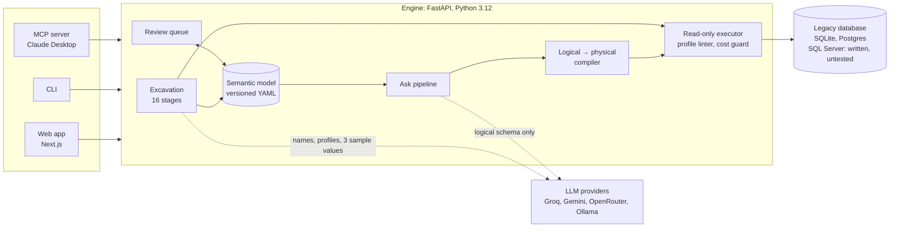
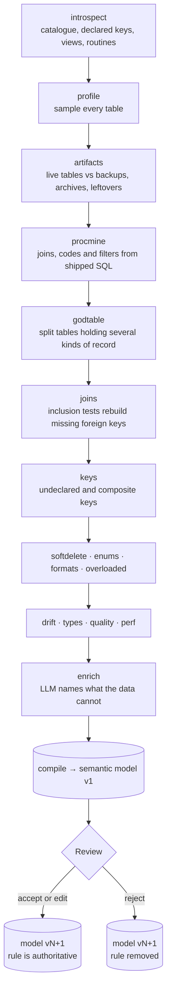
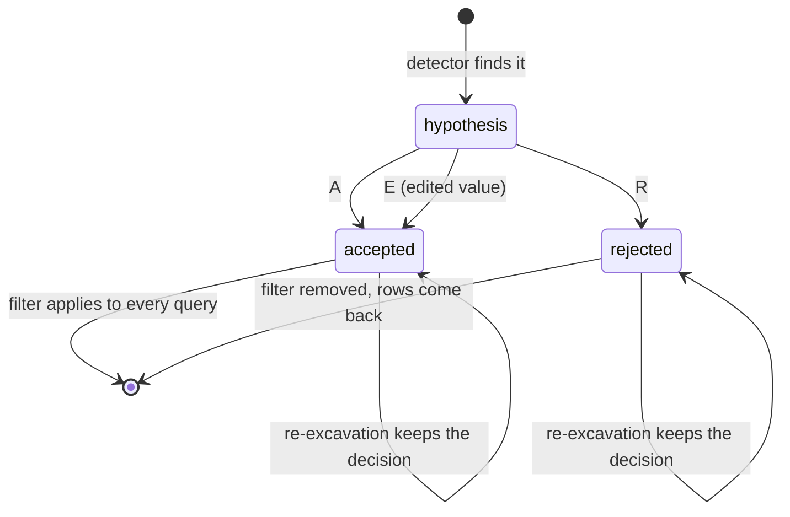
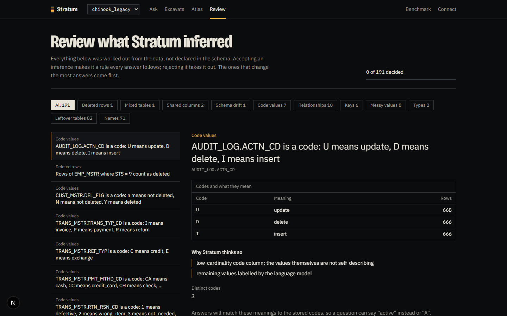
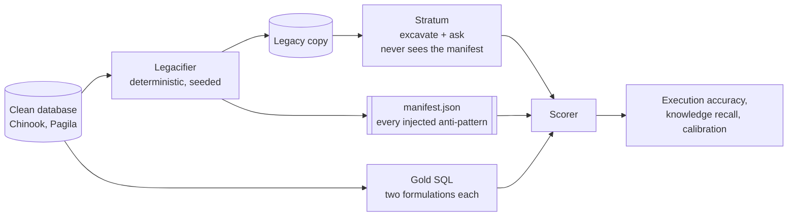
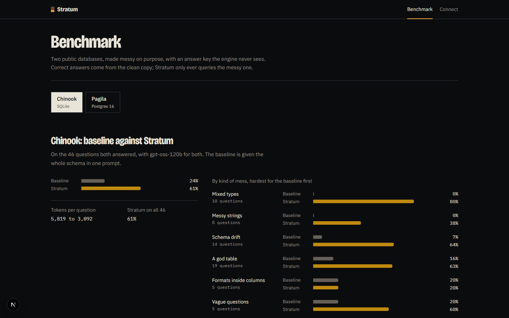
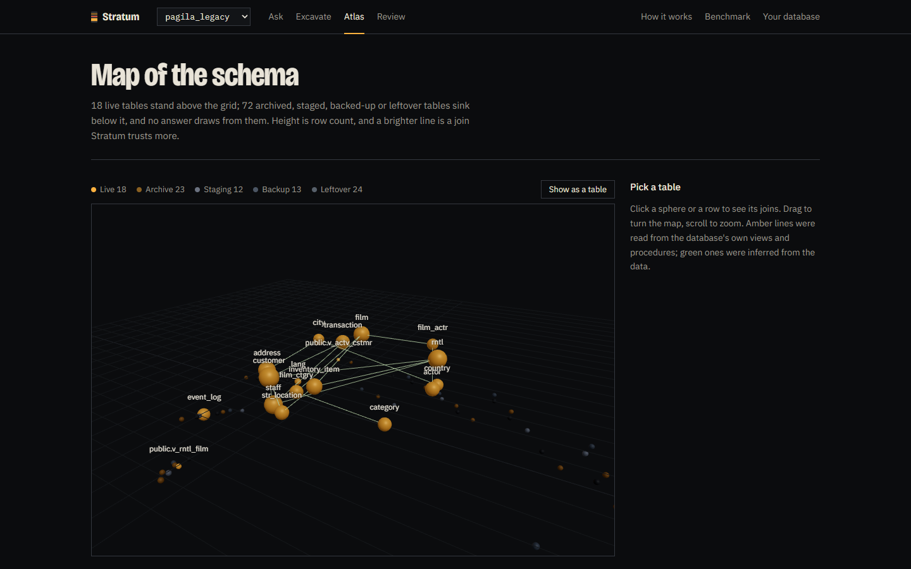

# Stratum

**Ask questions of databases nobody documented.**

A legacy database is sediment: thirty years of decisions nobody wrote down. Cryptic
names, no foreign keys, a 90-column table holding three different things, money stored
in dollars until 2023 and in cents afterwards, and rows that were never deleted, only
marked, in four different ways, because four different people solved it four different
times.

Stratum connects to one, excavates it, compiles what it finds into a semantic model a
person can read and correct, and answers questions against that clean logical layer.
Then it shows you every assumption it made.



The bet: **the language model writes SQL against a clean, virtual schema, and a
deterministic compiler rewrites it into the ugly physical reality.** Renames, casts on
mismatched join keys, soft-delete filters, god-table discriminators, XML extraction,
unit conversion and dialect downgrades are handled once, in reviewed code and YAML,
instead of being re-guessed by a model on every question.

```sql
-- what the model writes
SELECT COUNT(*) FROM customer

-- what actually runs
SELECT COUNT(*) FROM (
  SELECT CUST_ID AS id, RTRIM(LTRIM(CFNM1)) AS first_name, …
  FROM CUST_MSTR
  WHERE UPPER(COALESCE(DEL_FLG, 'N')) <> 'Y'
) AS customer
```

---

## Results

Measured on two legacified benchmark databases, each against a naive baseline on the
same model (whole schema in one prompt, no semantic layer):

| | Chinook, SQLite | Pagila, Postgres 16 |
|---|---:|---:|
| naive baseline | 23.9% | 30.8%\* |
| **Stratum** | **60.9%** | **57.8%** |
| tokens per question | 5,817 → **3,095** | 3,711 → **2,354**\* |
| structure recovered (join F1) | 1.00 | 0.85 |

\* Pagila's baseline covers 26 of 45 questions, because the free tier's daily budget ran
out; the Pagila token figures compare those same 26.

Where the gain comes from, on Chinook (same model, same questions, execution accuracy):

| Anti-pattern in the question | Baseline | Stratum |
|---|---:|---:|
| Mixed types (a date stored as text, a key as a string) | 0% | **80%** |
| Schema drift (a column that moved, a unit that changed) | 7.1% | **64.3%** |
| Soft deletes | 23.3% | **63.3%** |
| God table (one table holding several kinds of record) | 15.8% | **63.2%** |
| Vague question | 20% | **60%** |
| Missing foreign keys | 31.6% | **57.9%** |
| Messy strings (padding, case, spelling variants) | 0% | **37.5%** |

On Pagila, summing revenue through the excavated model returns the clean database's
total **to the cent**. That requires a god-table discriminator and a dollars-to-cents
cutover, both found from the data with no LLM involved. The plausible wrong answer is
0.6% away.

Methodology, caveats and everything that was fixed to get here are in
[docs/PROGRESS.md](docs/PROGRESS.md).

---

## How it fits together



Two paths share one model. **Excavation** runs once per database and is mostly
deterministic. **Asking** runs per question and leans on the model only for the part
that genuinely needs language: turning a question into SQL over clean names.

---

## Excavation



Each detector is a pure function in [engine/stratum/excavate/](engine/stratum/excavate/)
returning typed findings with `evidence` and `confidence`. The order matters: a god table
has to be split before its composite key is unique, and shipped SQL is mined before
joins are inferred, because a join written in a working view outranks any statistic.

Only the last stage calls a model, and only for what cannot be computed: what `'X'`
means in a status column, or what `CFNM1` is short for.

### Review

Every finding is a hypothesis until a person decides. The queue is ordered by impact,
uncertainty times how much depends on it, so the first thing asked about is the
soft-delete rule that changes every revenue answer, not a description on a lookup
table.





---

## Asking a question


The model never invents a join condition: the join graph is planned deterministically
and the conditions are handed to it. Two candidates are generated with different
strategies and compared by *result*, not by SQL text. A question stays under ~6K tokens,
which is what lets the whole thing run on free tiers.

### What the compiler does

```mermaid
flowchart LR
    logical["SELECT SUM(amount)<br/>FROM payment"] --> rename["names → physical columns"]
    rename --> god["god table → discriminator<br/>txn_typ = 'P'"]
    god --> soft["soft delete → live predicate<br/>rows with sts_cd = 'X' left out"]
    soft --> drift["drift → unit cutover<br/>cents after 2023"]
    drift --> types["casts on mismatched keys,<br/>dates parsed from text"]
    types --> dialect["dialect downgrade<br/>tsql2008: no OFFSET, IIF, LAG"]
    dialect --> physical["physical SQL<br/>that actually runs"]
```



---

## The Gauntlet

Accuracy claims are worthless without ground truth, so the benchmark is built rather
than annotated. A clean, well-known database is **legacified** deterministically into a
messy copy, and gold answers are computed on the clean one, so correctness is known
without hand-writing SQL for the mess.



The invariant that makes it work: **every transformation is reversible.** Soft-deleted
rows are *extra* rows that do not exist in the clean copy, never existing rows hidden,
so filtering them out reproduces the clean set exactly. `make gauntlet` asserts this (21
checks on Chinook, 27 on Pagila) and cross-checks two independent gold formulations per
question (46 and 45 pairs) before any accuracy number is believed.

The manifest is the answer key. Engine code never opens it, and nothing in the semantic
model of a benchmark database is written by hand.



---

## Non-negotiables

1. **Read-only, always.** Every statement is parsed with sqlglot; anything that is not a
   single SELECT is rejected before it reaches a driver. Execution runs in a transaction
   that is rolled back, under a statement timeout and a row cap.
2. **Credentials never reach a model**, and neither do full tables. It sees schema,
   profiles, and at most three sample values per column, each quoted as data.
3. **The answer key is never read by engine code.** Only the scorer opens `manifest.json`.
4. **The token budget is a hard constraint.** Where an answer can be computed
   deterministically, it is.
5. **Capability profiles are law.** Generated SQL must pass the connection's profile
   linter: `tsql2008` forbids `OFFSET/FETCH`, `IIF`, `CONCAT`, `TRY_CAST`, `LAG/LEAD`,
   JSON functions and `STRING_AGG`, whatever version the server reports.

---

## Quick start

No Docker, no API key and no cloud account are needed for the first part. Postgres runs
from a pip wheel.

```bash
make setup          # install the engine (uv, Python 3.12) and a local Postgres
make gauntlet       # build both benchmark databases, verify reversibility and gold
make excavate       # excavate one into a semantic model (SUITE=pagila_v1 for Postgres)
make test           # 124 tests, lint, typecheck
```

Paths are Windows-style (`.venv/Scripts/python.exe`); on macOS or Linux use
`.venv/bin/python`. Then look at what it found:

```bash
cd engine
.venv/Scripts/python.exe -m stratum.cli model chinook_legacy
.venv/Scripts/python.exe -m stratum.cli model chinook_legacy --entity billing
.venv/Scripts/python.exe -m stratum.cli review chinook_legacy
```

To answer questions you need a model provider. Any free tier works:

```bash
cp .env.example .env                   # then fill in GROQ_API_KEY, GEMINI_API_KEY or OPENROUTER_API_KEY
cd engine && .venv/Scripts/python.exe -m stratum.cli \
    ask chinook_legacy "how many customers placed an order in 2022?"
```

Run the app:

```bash
make engine         # API on :8000, docs at /docs
make web            # web app on :3000
```

| Page | What it is for |
|---|---|
| **Connect** | Pick a demo database or paste your own URL; credentials are stored encrypted |
| **Excavate** | Watch each stage report what it found |
| **Review** | Accept, reject or edit what was inferred, with the evidence in plain sentences |
| **Atlas** | The schema in 3D: live tables above the grid, excluded ones sunk below it |
| **Ask** | Questions, with the pipeline trace, the rules applied and both forms of the SQL |
| **Benchmark** | Every question's gold result next to Stratum's |

Or drive it from Claude Desktop with no API key at all: `make mcp` exposes ten tools
(search the model, plan joins, compile and validate SQL, run it read-only, propose
fixes). See [docs/MCP.md](docs/MCP.md).



---

## Layout

```
engine/     Python 3.12, FastAPI, sqlglot, SQLAlchemy Core, DuckDB
  stratum/connectors/   capability profiles, read-only executor, cost guard
  stratum/excavate/     one module per detector, then the model compiler
  stratum/semantic/     the model, its store, the verified query library
  stratum/ask/          link → plan → generate → compile → validate → explain
  stratum/llm/          one OpenAI-compatible client, four providers, a budgeter
  stratum/mcp/          the MCP server
gauntlet/   the legacifier, question suites, scorer, eval runner, published reports
web/        Next.js, TypeScript, Tailwind v4, GSAP, react-three-fiber
infra/      docker-compose for SQL Server and Postgres
docs/       PLAN.md (the build plan), PROGRESS.md (what is measured), MCP.md
```

## Status

Measured end to end on SQLite and Postgres; confidence calibration fitted; every web
page exercised in a browser.

Not done:
- **HALCYON, the SQL Server benchmark.** The connector and the `tsql2008` dialect linter
  are written and unit-tested but have never run against a live server. A draft
  legacifier (AdventureWorks into HALCYON) is on the
  [`halcyon-wip`](https://github.com/waleed-w-maqbool-m/stratum/tree/halcyon-wip) branch, unrun.
- The ablation report and a BIRD mini-dev run, each a day of free-tier budget.

[docs/PROGRESS.md](docs/PROGRESS.md) is explicit about what is verified and what is not.
