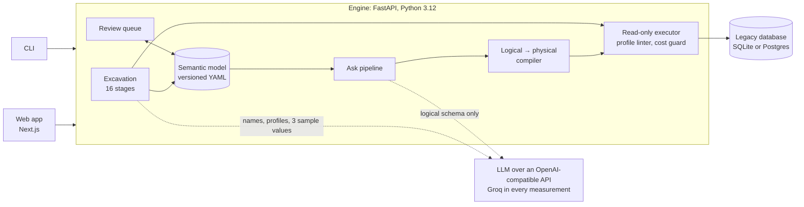
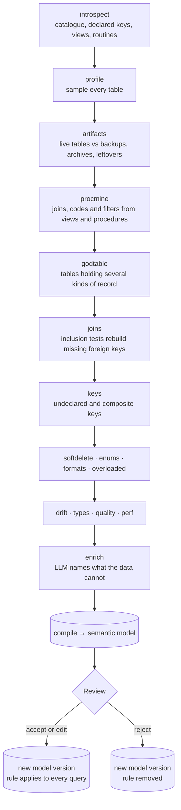
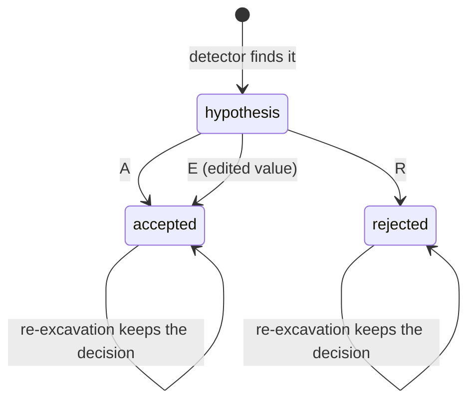
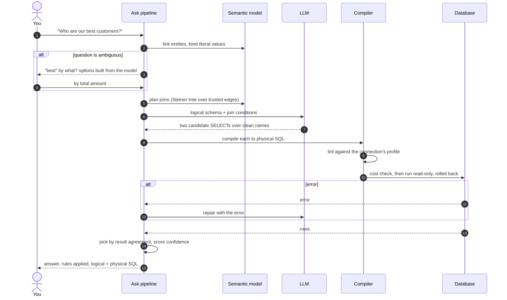
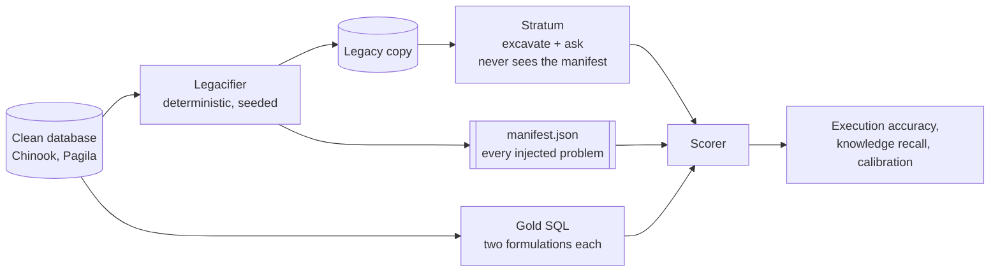
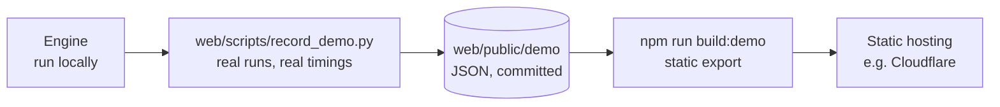

# Stratum

**Ask questions of databases nobody documented.**

Legacy databases accumulate decisions nobody wrote down: cryptic names, no foreign keys,
one table holding several kinds of record, money that switched from dollars to cents
partway through, and rows that were never deleted, only marked as deleted.

Stratum connects to such a database, works out what it means from the schema and the
data, compiles that into a semantic model a person can review and correct, and answers
plain-English questions against it, showing the SQL it ran and every rule it applied.


The core idea: **the language model writes SQL against a clean, virtual schema, and a
deterministic compiler rewrites it into the messy physical one.** Renames, casts on
mismatched join keys, soft-delete filters, table discriminators and unit conversions are
applied by reviewed code, not re-guessed by a model on every question.

A real answer from the benchmark's Postgres database (physical SQL abridged):

```sql
-- what the model wrote
SELECT SUM(amount) AS total_revenue FROM payment WHERE txn_typ = 'P'

-- what ran on the database
SELECT SUM(amount) AS total_revenue FROM (
  SELECT …,
         CASE WHEN txn_ts >= '2022-04-01 00:02:24.640021'
              THEN amt_c / 100.0 ELSE amt END AS amount
  FROM public.fin_txn
  WHERE txn_typ = 'P'
) AS payment
```

It returns 67,416.51, the clean database's total to the cent. Getting there needs two
facts found in the data, not in the schema: `fin_txn` mixes payments with other record
types, and amounts moved from a dollars column to a cents column on a cutover date.

---

## Results

Measured on two public sample databases that were deliberately made messy (see
[The Gauntlet](#the-gauntlet)). Each is compared against a naive baseline using the same
model: the whole schema in one prompt, no semantic layer.

| | Chinook, SQLite | Pagila, Postgres 16 |
|---|---:|---:|
| model (Groq free tier) | `gpt-oss-120b` | `qwen3.8-27b` |
| naive baseline | 23.9% | 30.8%\* |
| **Stratum** | **60.9%** | **57.8%** |
| tokens per question | 5,817 → **3,095** | 3,711 → **2,354**\* |
| joins recovered (F1) | 1.00 | 0.85 |

Execution accuracy: Stratum's result rows compared with the gold query's on the clean
database.

\* Pagila's baseline covers 26 of 45 questions, because the free tier's daily token budget
ran out; the Pagila token figures compare those same 26.

Where the gain comes from, on Chinook (same model, same questions):

| Problem the question runs into | Baseline | Stratum |
|---|---:|---:|
| Mixed types (a date stored as text, a key as a string) | 0% | **80%** |
| Schema drift (a column that moved, a unit that changed) | 7.1% | **64.3%** |
| Soft deletes | 23.3% | **63.3%** |
| One table holding several kinds of record | 15.8% | **63.2%** |
| Vague question | 20% | **60%** |
| Missing foreign keys | 31.6% | **57.9%** |
| Messy strings (padding, case, spelling variants) | 0% | **37.5%** |

Methodology, caveats and everything fixed along the way:
[docs/PROGRESS.md](docs/PROGRESS.md).

---

## How it fits together



Excavation runs once per database and is mostly deterministic. Answering runs per
question and uses the model only to turn a question into SQL over clean names.

---

## Excavation



Each detector is a pure function in [engine/stratum/excavate/](engine/stratum/excavate/)
that returns typed findings with evidence and a confidence. Only the last stage calls a
model, and only for what cannot be computed, such as what `'X'` means in a status
column or what `CFNM1` is short for.

### Review

Every finding is a hypothesis until a person decides. The queue is ordered by impact, so
the first thing asked about is the soft-delete rule that changes every revenue answer,
not a description on a lookup table. Decisions survive re-excavation.




---

## Asking a question



The model never invents a join condition: joins are planned deterministically and handed
to it. A question has a 6,000-token budget, which is what lets the system run on free
tiers.

### What the compiler does

```mermaid
flowchart LR
    logical["SELECT SUM(amount)<br/>FROM payment"] --> rename["names → physical columns"]
    rename --> god["mixed table → discriminator<br/>txn_typ = 'P'"]
    god --> soft["soft delete → live rows only"]
    soft --> drift["unit change → dollars and cents<br/>reconciled at the cutover"]
    drift --> types["casts on mismatched keys,<br/>dates parsed from text"]
    types --> lint["checked against the<br/>connection's SQL profile"]
    lint --> physical["physical SQL<br/>that actually runs"]
```



---

## The Gauntlet

Accuracy claims need ground truth, so the benchmark is built rather than annotated. Two
public sample databases, Chinook (SQLite) and Pagila (Postgres 16), are **legacified**
deterministically into messy copies. Gold answers are computed on the clean originals,
so correctness is known without hand-writing SQL for the mess.



**Every transformation is reversible.** Soft-deleted rows are *extra* rows that don't
exist in the clean copy, so filtering them out reproduces the clean set exactly.
`make gauntlet` checks this (21 checks on Chinook, 27 on Pagila) and cross-checks two
independent gold queries per question (46 and 45 pairs) before any score is trusted.

The manifest is the answer key. Engine code never opens it, and no part of either
benchmark's semantic model was written by hand.


---

## Guarantees

1. **Read-only.** Every statement is parsed with sqlglot, and anything that is not a
   single SELECT is rejected before it reaches a driver. Execution runs in a transaction
   that is rolled back, with a statement timeout and a row cap.
2. **Credentials never reach a model**, and neither do whole tables. A model sees the
   schema, column profiles and at most three sample values per column.
3. **The answer key is never read by engine code.** Only the scorer opens `manifest.json`.
4. **A token budget per question.** Anything that can be computed deterministically is.
5. **SQL profiles.** Generated SQL must pass the connection's capability-profile linter
   before it runs.

---

## Running it

No Docker and no cloud account needed. Postgres runs from a pip wheel (`pgserver`).

```bash
make setup          # install the engine (uv, Python 3.12) and a local Postgres
make gauntlet       # build both benchmark databases, verify reversibility and gold
make excavate       # excavate one into a semantic model (SUITE=pagila_v1 for Postgres)
make test           # 125 tests, plus lint and the web typecheck
```

Commands use Windows paths (`.venv/Scripts/python.exe`); on macOS or Linux use
`.venv/bin/python`. Look at what excavation found:

```bash
cd engine
.venv/Scripts/python.exe -m stratum.cli model chinook_legacy
.venv/Scripts/python.exe -m stratum.cli review chinook_legacy
```

Answering questions needs an LLM key. All results above used Groq's free tier:

```bash
cp .env.example .env                   # then set GROQ_API_KEY
cd engine && .venv/Scripts/python.exe -m stratum.cli \
    ask chinook_legacy "how many customers placed an order in 2022?"
```

Run the app:

```bash
make engine         # API on :8000
make web            # web app on :3000
```

| Page | What it is for |
|---|---|
| **Connect** | Open a benchmark database, or paste your own URL; credentials are stored encrypted |
| **Excavate** | Watch each stage report what it found |
| **Review** | Accept, reject or edit what was inferred, with the evidence in plain sentences |
| **Atlas** | The schema in 3D: live tables above the grid, excluded ones sunk below it |
| **Ask** | Questions, with the pipeline trace, the rules applied and both forms of the SQL |
| **Benchmark** | Every question's gold result next to Stratum's |


---

## Static demo build

The web app also builds as a static site that needs no engine and no API key, intended
for free hosting on Cloudflare. Its data was recorded from the real engine:
excavations and answers replay event by event at the pace they originally ran, so every
page and animation works. Every recorded answer was checked against the clean database
before it was kept.



In the static build, a visitor can ask the listed questions (including the clarification
and cost-warning branches), replay an excavation, use Review, explore the Atlas and read
the full Benchmark. A brand-new question or a new database needs the engine running
locally, and the site says so.

The build has been tested locally as plain static files in Chrome, at desktop and phone
widths, and `wrangler deploy --dry-run` reads its output correctly. It has not been
deployed yet.

It deploys to Cloudflare as a Workers project serving static assets
([web/wrangler.toml](web/wrangler.toml)). `wrangler deploy` runs the build itself, so one
command is enough. From the dashboard, create a Workers project from this repository and
set:

| Setting | Value |
|---|---|
| Root directory | `web` |
| Build command | leave empty (`wrangler.toml` runs `npm run build:demo`) |
| Deploy command | `npx wrangler deploy` |

The root directory has to be `web`: that is where `wrangler.toml` and `package.json` are,
and without it Cloudflare finds no config and no assets. Or deploy from your machine:

```bash
cd web
npm ci
npx wrangler login
npm run deploy:demo
```

---

## Layout

```
engine/     Python 3.12, FastAPI, sqlglot, SQLAlchemy Core, networkx, DuckDB
  stratum/connectors/   connectors, capability profiles, read-only executor, cost guard
  stratum/excavate/     one module per detector, then the model compiler
  stratum/semantic/     the model, its store, the review queue
  stratum/ask/          link → plan → generate → compile → validate → explain
  stratum/llm/          one OpenAI-compatible client, rate budgeting, response cache
gauntlet/   legacifiers, question suites, scorer, eval runner, published reports
web/        Next.js, TypeScript, Tailwind v4, GSAP, react-three-fiber
docs/       PLAN.md (the original build plan), PROGRESS.md (what was measured)
```

## Limitations

- **Two databases, one model each.** Results are from Chinook and Pagila only. Pagila's
  baseline is partial (26 of 45 questions), and the confidence calibration was fitted
  on the same questions it is reported on.
- **SQLite and Postgres only.** The code has a SQL Server connector and a SQL Server
  2008 profile, but neither has run against a real server; the Docker setup for it
  (`infra/`) was abandoned.
- **The enrichment step varies between runs.** Re-excavating the same database can name
  columns or decode codes differently, because that step depends on the language model.
- **A cached answer skips the cost check** that its first run went through.
- **The MCP server** (`engine/stratum/mcp/`, [docs/MCP.md](docs/MCP.md)) is written but
  has not been tested with a client.
- Not done from the original plan: an ablation report and a run on the BIRD benchmark.
